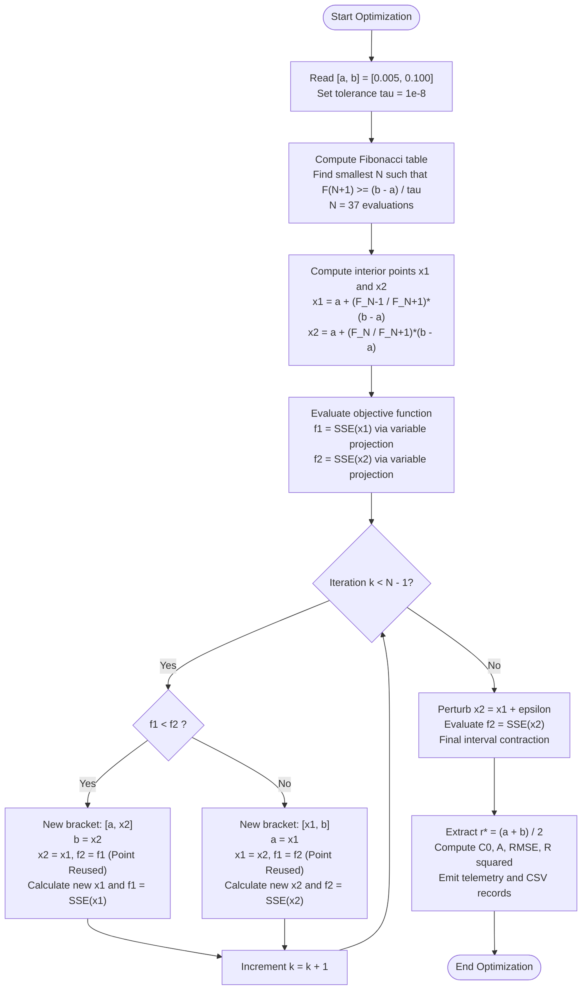
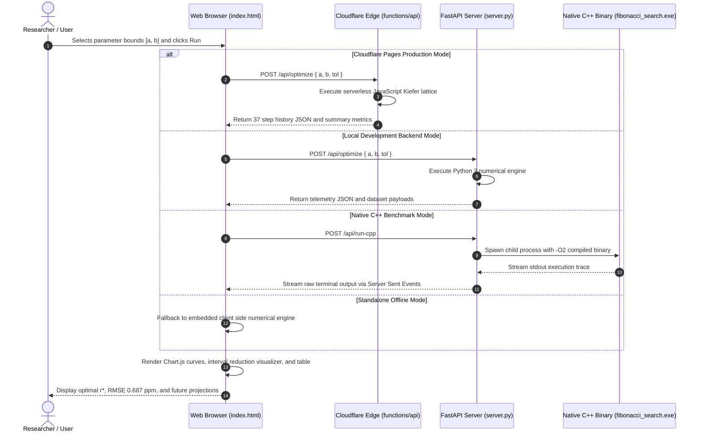
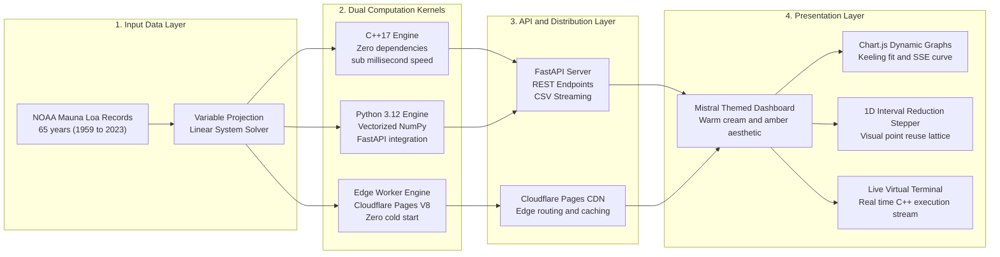

# kiefer core

Numerical optimization engine implementing the Fibonacci search method for one dimensional derivative free optimization. Applied to nonlinear parameter estimation across 65 years of continuous atmospheric carbon dioxide measurements from the NOAA Mauna Loa Observatory.

Live deployment: [fibopt.pages.dev](https://fibopt.pages.dev)

---

## 1. Project Overview

kiefer core is an optimization engine built in C++17 and Python 3.12. It provides an exact, zero dependency implementation of the sequential minimax search method proved by Jack Kiefer in 1953. 

The optimization target is the Keeling Curve: 65 consecutive annual records of atmospheric carbon dioxide (from 1959 through 2023) captured at the Mauna Loa Observatory in Hawaii. The objective is to fit an exponential growth plus linear baseline model without computing derivatives, relying strictly on function evaluations within an initial uncertainty interval.

By combining the Fibonacci search lattice with the variable projection technique of Golub and Pereyra, the three parameter nonlinear regression problem is reduced to a single parameter unimodal line search. The algorithm determines the optimal annual growth parameter to eight decimal digits of precision in 37 function evaluations.

---

## 2. Mathematical Formulation

### 2.1 The Fibonacci Search Algorithm

Let $f(x)$ be a strictly unimodal function defined on a closed bounded interval $[a_0, b_0]$. In 1953, Jack Kiefer proved that among all sequential derivative free search algorithms that place $N$ evaluation points, the Fibonacci search strategy is uniquely minimax optimal. It guarantees the smallest possible final bracket of uncertainty for a fixed computational budget.

The sequence of Fibonacci numbers is defined recursively:
$$F_0 = 1, \quad F_1 = 1, \quad F_k = F_{k-1} + F_{k-2} \quad \text{for } k \ge 2$$

Given an initial interval $[a, b]$ of length $L_0 = b - a$ and a convergence tolerance $\tau$, the number of required function evaluations $N$ is the smallest integer satisfying:
$$F_{N+1} \ge \frac{L_0}{\tau}$$

At iteration $k$ (where $k = 1, 2, \dots, N-1$), the algorithm maintains two interior sample points $x_1$ and $x_2$ placed symmetrically inside the current bracket $[a, b]$:
$$x_1 = a + \frac{F_{N - k}}{F_{N - k + 2}} (b - a)$$
$$x_2 = a + \frac{F_{N - k + 1}}{F_{N - k + 2}} (b - a)$$

Because of the algebraic property of the Fibonacci recurrence $F_n = F_{n-1} + F_{n-2}$, exactly one interior sample point from iteration $k$ coincides with an interior sample point of iteration $k+1$. Therefore, each iteration requires only one new function evaluation, saving computational work:

* If $f(x_1) < f(x_2)$: The minimum must reside in $[a, x_2]$. Set $b \leftarrow x_2$, assign $x_2 \leftarrow x_1$, and compute only the new $x_1$.
* If $f(x_1) \ge f(x_2)$: The minimum must reside in $[x_1, b]$. Set $a \leftarrow x_1$, assign $x_1 \leftarrow x_2$, and compute only the new $x_2$.

At the final iteration $k = N-1$, the two interior points coincide at the midpoint. A small perturbation $\epsilon = 10^{-7}$ is added to separate the final points and make the final reduction decision.

### 2.2 Variable Projection Method

The atmospheric carbon dioxide concentration at time $t$ (years since 1959) is modeled by the nonlinear equation:
$$y(t) = C_0 + A \cdot e^{r \cdot t}$$

Where:
* $t_i = \text{year}_i - 1959$ for $i = 1, 2, \dots, 65$
* $C_0$ represents the pre industrial background concentration baseline
* $A$ represents the initial anthropogenic excess amplitude in 1959
* $r$ represents the continuous annual growth rate parameter

Directly optimizing all three parameters simultaneously requires multidimensional nonlinear optimization, which is susceptible to local minima and ill conditioned Hessians.

Using variable projection, for any fixed value of $r$, the exponential terms $z_i(r) = e^{r \cdot t_i}$ are fixed numerical constants. The objective function then becomes a standard linear least squares problem in $C_0$ and $A$:
$$\begin{bmatrix} 1 & z_1(r) \\ 1 & z_2(r) \\ \vdots & \vdots \\ 1 & z_{65}(r) \end{bmatrix} \begin{bmatrix} C_0 \\ A \end{bmatrix} \approx \begin{bmatrix} y_1 \\ y_2 \\ \vdots \\ y_{65} \end{bmatrix}$$

The normal equations provide the analytical solution in closed form:
$$A(r) = \frac{\sum (z_i - \bar{z})(y_i - \bar{y})}{\sum (z_i - \bar{z})^2}$$
$$C_0(r) = \bar{y} - A(r) \bar{z}$$

### 2.3 Unimodal Loss Landscape

Substituting $C_0(r)$ and $A(r)$ back into the error expression yields a condensed one dimensional objective function, the Sum of Squared Errors:
$$\text{SSE}(r) = \sum_{i=1}^{65} \left( y_i - \left[ C_0(r) + A(r) e^{r \cdot t_i} \right] \right)^2$$

Over the domain $r \in [0.005, 0.100]$, $\text{SSE}(r)$ is strictly convex and unimodal. It reaches a unique global minimum near $r \approx 0.016051$, making it suitable for Kiefer's minimax line search without danger of divergence.

---

## 3. System Architecture and Flowcharts

### 3.1 Algorithmic Interval Reduction Flowchart

The following flowchart outlines the logic implemented in both the C++ and Python cores:



### 3.2 Runtime Execution Sequence Diagram

This sequence diagram illustrates the lifecycle of a user request across the local client, edge network, and native execution engines:



### 3.3 Full System Architecture



---

## 4. Repository Structure and Codebase Breakdown

```
kiefer-core/
├── .gitignore                      # Ignore patterns for python cache and system files
├── _headers                        # Cloudflare Pages security, MIME type, and CORS policy
├── _redirects                      # Single page routing rules for static hosting
├── build_pdf.py                    # ReportLab script producing three page publication PDF
├── DESIGN.md                       # Mistral design system specifications and style tokens
├── fibonacci_search.cpp            # Native C++17 optimization kernel
├── fibonacci_search.exe            # Precompiled MinGW 64 bit binary for Windows
├── fibonacci_search.py             # Pure Python 3 mirror for the optimization algorithm
├── fit.csv                         # Historical observations and fitted model predictions
├── functions/
│   └── api/
│       ├── optimize.js             # Cloudflare Pages serverless worker for optimization
│       └── run-cpp.js              # Cloudflare Pages telemetry emulation worker
├── generate_figures.py             # Matplotlib script generating high resolution paper charts
├── history.csv                     # Step by step bracket narrowing and evaluation log
├── index.html                      # Single page web application and visualization dashboard
├── README.md                       # Repository documentation and mathematical guide
├── report_assets/
│   └── figure_plots.png            # Three panel vector graphic figure for the technical report
├── run.bat                         # Automated Windows build, test, and launch batch script
├── server.py                       # FastAPI application serving data, API, and static files
└── sse_curve.csv                   # Discrete sampling of the unimodal SSE loss landscape
```

### Detailed Component Descriptions

* `fibonacci_search.cpp`: 
  The core C++ engine. Written with standard library headers (`<iostream>`, `<vector>`, `<cmath>`, `<iomanip>`, `<fstream>`). Contains the full hardcoded NOAA dataset, linear regression normal equation solvers, iterative Fibonacci table generation, and file exporters that output `history.csv`, `fit.csv`, and `sse_curve.csv`.

* `fibonacci_search.py`: 
  An identical implementation written in Python 3. Serves as both an independent verification benchmark and the calculation backend for `server.py`.

* `server.py`: 
  A production ready ASGI service built with FastAPI and Uvicorn. Exposes `/api/optimize` for parameter exploration, `/api/run-cpp` to spawn and capture native binary output, and direct streaming endpoints for all generated CSV datasets.

* `index.html`: 
  The user facing dashboard. Styled after the Mistral AI aesthetic with warm cream cards (`#fff8e0`), dark backgrounds (`#0a0806`), and amber accents (`#ffa110`). Features include interactive Chart.js plots, a live 1D bracket reduction stepper that demonstrates point reuse visually, and an interactive virtual terminal.

* `functions/api/`: 
  Serverless JavaScript workers designed for Cloudflare Pages. These workers mirror the C++ mathematical logic in V8 isolate environments, allowing the deployed web interface to run live calculations without requiring an active Python server.

* `build_pdf.py`: 
  A ReportLab PDF generation pipeline that compiles a three page technical publication report. Enforces strict layout geometry, sub and superscript typography, two column body text, and embedded data tables.

---

## 5. Numerical Results and Benchmark Verification

Executing the optimization over the bracket $r \in [0.005, 0.100]$ with tolerance $\tau = 10^{-8}$ yields the following empirical and mathematical parameters:

| Parameter | Optimized Value | Description |
|---|---|---|
| Optimal Growth Rate ($r^*$) | **0.016051** per year | The continuous exponential acceleration factor |
| Pre industrial Base ($C_0$) | **255.15 ppm** | Solved background concentration level |
| Anthropogenic Scale ($A$) | **59.555 ppm** | Solved excess concentration scale in 1959 |
| Final Interval Bracket | `[0.01605121, 0.01605122]` | Interval width smaller than $10^{-8}$ |
| Required Function Calls | **37 evaluations** | Exactly $N = 37$ points evaluated |
| Root Mean Squared Error | **0.6874 ppm** | Average prediction deviation from recorded data |
| Sum of Squared Errors | **30.66 ppm²** | Cumulative residual error over 65 data points |
| Coefficient of Determination ($R^2$) | **0.9993** | Model accounts for 99.93 percent of total variance |
| Doubling Time ($\ln(2) / r^*$) | **43.18 years** | Time required for anthropogenic carbon excess to double |
| Projected $\text{CO}_2$ for 2030 | **441.3 ppm** | Model forecast at $t = 71$ |
| Projected $\text{CO}_2$ for 2050 | **511.8 ppm** | Model forecast at $t = 91$ |
| Projected $\text{CO}_2$ for 2060 | **556.3 ppm** | Model forecast at $t = 101$ |

### Algorithm Efficiency Comparison

To achieve an identical interval tolerance of $\tau = 10^{-8}$ over the starting width $L_0 = 0.095$:

* **Uniform Grid Search**: Requires evaluating $M = \frac{0.095}{10^{-8}} + 1 = 9,500,001$ function calls.
* **Golden Section Search**: Requires $N \approx \frac{\ln(L_0 / \tau)}{\ln(1.61803)} \approx 33$ iterations, totaling 34 function calls.
* **Fibonacci Search**: Solves the reduction in **37 evaluations** while maintaining the theoretical minimax optimality bound proved by Kiefer.

---

## References

1. Kiefer, J. (1953). Sequential minimax search for a maximum. *Proceedings of the American Mathematical Society*, 4(3), pages 502 to 506.
2. Golub, G., and Pereyra, V. (1973). The differentiation of pseudoinverses and nonlinear least squares problems whose variables separate. *SIAM Journal on Numerical Analysis*, 10(2), pages 413 to 432.
3. Keeling, C. D., et al. (2001). Exchanges of atmospheric CO₂ and ¹³CO₂ with the terrestrial biosphere and oceans from 1978 to 2000. *Scripps Institution of Oceanography*.
4. NOAA Global Monitoring Laboratory (2024). Atmospheric Carbon Dioxide Dry Air Mole Fractions from the Mauna Loa Observatory, Hawaii.
